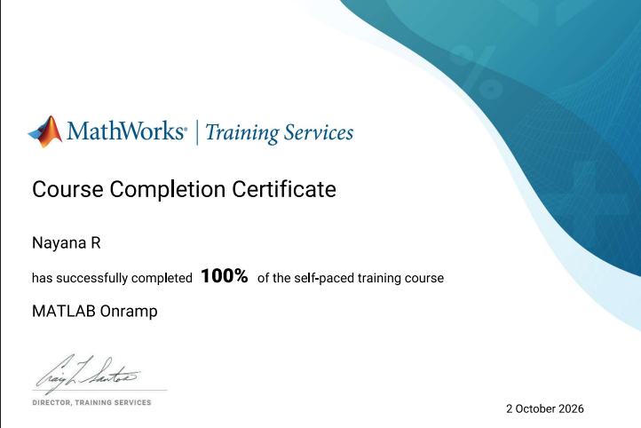
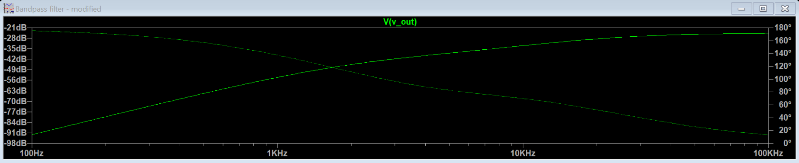
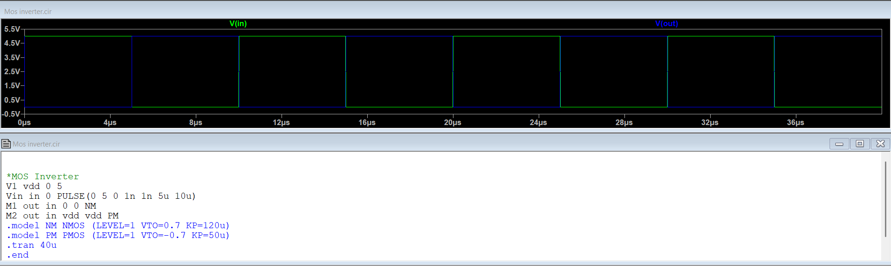
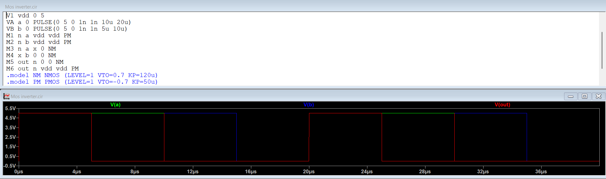
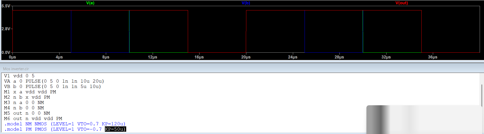
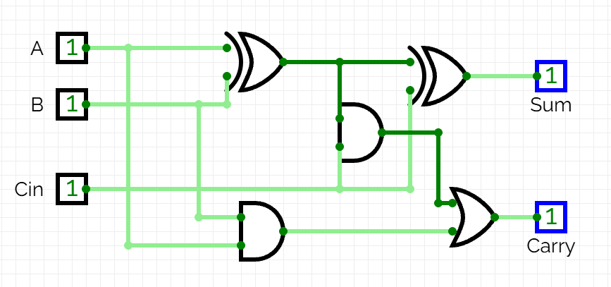
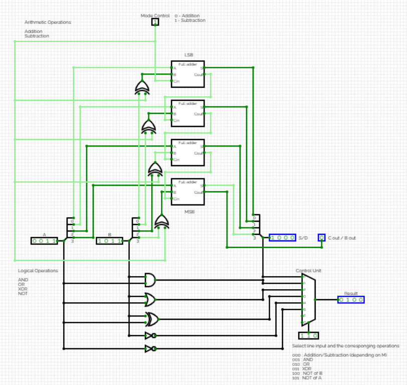
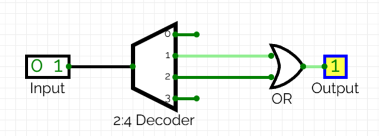

# Level 1 Report
# Electronic Design

## TASK 1: Engineer’s Swiss Army Knife
Objective:

To get familiar with the basics of MATLAB through the Onramp course available on its official website.

I created a MATLAB account and completed the MATLAB Onramp course, which helped me gain a basic understanding of MATLAB and its features. I became familiar with the MATLAB interface, including the Command Window, Workspace, and Editor. I learned basic syntax, variable creation, saving and loading MAT files, and commands such as clear and clc. I also worked with vectors, matrices, array indexing, the colon operator, and linspace to generate evenly spaced values. In addition, I practiced mathematical and statistical operations, logical indexing, relational operators, conditional statements, and for loops. I learned to use plotting functions such as plot and customize graphs using titles, axis labels, legends, colors, and markers. I also explored tables, built-in functions, and MATLAB documentation to understand the usage of different commands. These concepts helped me develop a foundation in MATLAB programming and data visualization.

**Project STELLAR MOTION:** The project focused on estimating the speed of a star relative to Earth by analyzing its spectrum. I generated a wavelength vector using the given starting wavelength, wavelength spacing, and number of observations. I then extracted the spectrum of the star HD 94028 from the sixth column of the given matrix and plotted its intensity against wavelength. Using the `min` function, I identified the hydrogen-alpha absorption line and marked it on the graph. The observed wavelength was compared with the known laboratory wavelength to understand the redshift and its relationship with the star’s motion relative to Earth.

Outcome:

Familiarized myself with the basics of MATLAB and gained hands-on experience using MATLAB for a realistic and interesting analysis.

## TASK 2: Cut, Pass, Repeat

Objective:

To learn about Band Pass Filters and design a second order active band pass filter(using OpAmps) that amplifies the signal to roughly 1.5 times the original signal with cutoff range between 4kHz and 10kHz

Methodology:
I first designed the bandpass filter according to the given specifications. The design is shown in the below image:

I then created a schematic of the designed circuit in LTSpice and simulated it to see the frequency response of the filter as shown below:

## TASK 3: SPICEy Code
Objective:

To learn SPICE code and write basic SPICE code for a MOS inverter, AND, and OR gates.

Implimentation:

MOS_Inverter

And gate

OR Gate

SPICE code is a set of written instructions that tell the simulator what components are in the circuit, how they are connected, and what type of analysis to perform.

Outcome:
Learned how to write SPICE code and implemented basic gates using SPICE code.
## TASK 6: 4 Bits to Rule Them All
Objective:

To design and implement a 4-bit Arithmetic Logic Unit (ALU) that performs the following operations: addition, subtraction (using 2’s complement), and logical operations (AND, OR, XOR) in CircuitVerse. And also to design a control unit to select the desired operation based on input signals and display the result along with any carry/overflow flags when applicable.The ALU must be efficient in terms of gate usage and scalable for future expansion.

Methodology:

After going through several resources, I understood what an ALU is and got an idea regarding the process of designing and simulating one. I first created a full adder circuit in circuitverse using basic logic gates.

Using that as a subcircuit, I created a 4-bit adder, ensuring correct handling of carry bits. I then extended this design to support subtraction by using 2’s complement. These perform the arithmetic operations of the ALU ie. addition and subtraction. I then implemented the logical functions AND, OR, XOR and also negation/inversion with the same 4-bit inputs. These perform the logical operations of the ALU. I used a multiplexer to select the desired operation based on input signals, which serves as the control unit. The required result is displayed appropriately.

Outcome:

I learnt the working of an ALU and also learnt how to design and simulate one. I also familiarised with circuitverse.

## TASK 7: The PCB Revolution

Objective:

To Learn basics of PCB Designing by applying for the Altium student license and completing the Altium Student Lab PCB coursework.

Methodology:

I applied for and recieved the Altium student license and completed the Altium Student Lab PCB coursework. In this process I learnt the basics of PCB designing, including Schematics and Libraries, PCB Layout, Routing and Basic Signal Integrity, PCB Manufacturing and Fundamentals of Purchasing and Supply Chain. After clearing the final quiz, I recieved my certificate.

## TASK 8: Convolution Countdown

Objective:

To theoretically learn basics of Digital Signal Processing and perform convolution using MATLAB.

Methodology:

I learnt the basics of DSP including an introduction to signals, systems and mathematical transforms such as Z-Transform and Fourier Transform.

Outcome:

I understood the basics of DSP theoretically, and also learnt to perform convolution operation in MATLAB.

## TASK 10: Your Logic, Preloaded

Objective:

To understand the concept of Look-Up Tables (LUTs) and to implement a 2-input XOR function using a 4x1 LUT (2 input bits select one of 4 pre-stored outputs).

Methodology:

 First,I wrote the truth table for XOR.

Then, I programmed a 4x1 LUT with the correct outputs based on the truth table.

I Simulated how inputs select different stored outputs.

Theory:

A lookup table (LUT) is a memory-based method used to store precomputed output values corresponding to different input combinations, so that instead of calculating a result each time, the system simply “looks up” the answer from the table. It is widely used in digital systems, FPGAs, signal processing, and computing to implement logic functions, mathematical operations, or complex mappings quickly and efficiently.

Outcome:

I understood the concept of Look-Up Tables (LUTs) and learnt to implement LUTs according to our requirements.

 